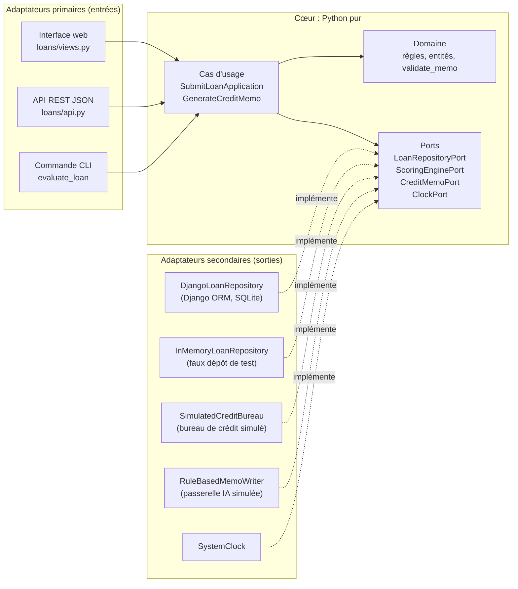
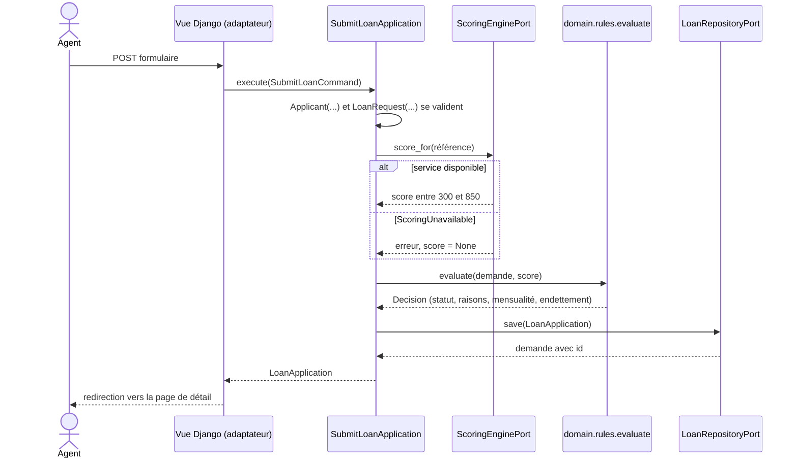

# Architecture et guide d'oral

## 1. L'idée en une phrase

> Le cœur ne connaît pas Django ; Django se branche sur le cœur.

Le cœur définit des **ports** (interfaces `typing.Protocol`). Les **adaptateurs** les implémentent.
Les dépendances pointent toujours vers l'intérieur : c'est la *règle de dépendance* de la Clean Architecture,
appliquée ici avec le vocabulaire « ports et adaptateurs » de l'architecture hexagonale.

## 2. Vue d'ensemble

Inversion de dépendance : à l'exécution, le cas d'usage appelle l'adaptateur ; au niveau du code source, c'est
l'adaptateur qui importe et implémente le port défini par le cœur (flèches pointillées).

## 3. Séquence : soumettre une demande

## 4. Où vit chaque chose

| Dossier / fichier | Rôle | Peut importer |
|---|---|---|
| `loan_core/domain/` | entités, objets-valeurs, règles de décision | rien d'externe |
| `loan_core/application/` | ports, cas d'usage | `domain` |
| `loan_adapters/` | mémoire, scoring simulé, rédacteur de mémo simulé, horloge | `application`, `domain` |
| `loans/` | ORM, vues HTML, API JSON, commande CLI, composition root | tout ce qui précède, et Django |

`loans/composition.py` est le **seul** endroit où l'on choisit les adaptateurs concrets (composition root).

## 5. Contrats d'architecture (`.importlinter`)

1. **Core must not depend on Django or on outer layers** : `loan_core` n'importe ni `django`, ni `loan_adapters`, ni `loans`.
2. **Pure adapters must not depend on Django** : `loan_adapters` reste indépendant de Django.
3. **Layered architecture** : `loans` → `loan_adapters` → `loan_core.application` → `loan_core.domain` (jamais l'inverse).

`tests/architecture/test_architecture.py` vérifie que le projet respecte les contrats **et** que chaque contrat détecte bien
une violation (on teste le test).

## 6. Comparaison avec les alternatives

Les cases ci-dessous sont **notre appréciation qualitative** pour ce prototype, pas des résultats de recherche.
Seules les mesures de temps viennent de nos propres exécutions (`scripts/benchmark.py`, à relancer sur votre machine).

| Critère | Hexagonale / Clean (ce projet) | MVC/MVT Django classique en couches | Transaction Script |
|---|---|---|---|
| Vitesse des tests du métier | très rapide : cœur testé sans base (mesuré : 83 tests ≈ 0,1 s) | plus lente : les tests passent par le framework et la base | dépend ; la logique est souvent mêlée aux accès aux données |
| Remplacer un adaptateur (base, API) | simple : un nouvel adaptateur derrière le même port | possible mais le framework est omniprésent | difficile : SQL et logique mélangés |
| Charge cognitive | plus élevée : ports, adaptateurs, composition root | faible, convention Django connue | très faible au départ |
| Maintenabilité d'un métier riche | bonne : règles isolées et contrôlées par import-linter | moyenne : la logique glisse vers vues et modèles | faible quand le métier grossit |
| Quand l'utiliser | métier complexe, longue durée de vie | CRUD, prototypes rapides | petits scripts simples |

Sources de référence **à vérifier et à citer avec leur date d'accès** : Cockburn (2005), Martin (2012), Percival & Gregory
(*Cosmic Python*), Fowler, *Patterns of Enterprise Application Architecture* (2002, pour Transaction Script et Unit of Work),
documentation Django. Le patron **Unit of Work** est présenté en théorie uniquement : il n'est pas implémenté dans ce prototype.

Choix **de notre prototype** (et non des sources) : un domaine volontairement petit, pour que la structure reste visible.

## 7. Questions d'oral probables

**C'est quoi l'architecture hexagonale ?**
Le métier est au centre, en Python pur. Les technologies (Django, base, API externe) se branchent par des ports et des adaptateurs.

**Pourquoi ne pas tout mettre dans `views.py` et `models.py` ?**
Parce qu'on ne pourrait pas tester les règles sans base de données, et changer de technologie obligerait à réécrire le métier.

**C'est quoi un port, un adaptateur ?**
Un port est une interface définie par le cœur (`LoanRepositoryPort`). Un adaptateur est son implémentation concrète
(`DjangoLoanRepository` ou `InMemoryLoanRepository`).

**Quel est le lien avec l'injection de dépendances ?**
Les cas d'usage reçoivent leurs ports par le constructeur. Le choix des adaptateurs se fait dans `loans/composition.py`.
Même principe qu'une interface Java ou C# injectée.

**Que fait `import-linter` ?**
Il analyse les imports du code et fait échouer la vérification si une règle de dépendance est violée, par exemple si le domaine importe Django.
Démonstration : `python scripts\demo_violation.py`.

**Pourquoi un modèle Django *et* une entité du domaine ?**
L'entité est le concept métier ; le modèle n'est que sa forme stockée. Le dépôt Django fait la traduction dans les deux sens.

**Que se passe-t-il si le service de scoring tombe ?**
L'adaptateur lève `ScoringUnavailable`, le cas d'usage met le score à `None`, et la règle renvoie « À examiner » : jamais d'acceptation automatique.

**Pourquoi des tests de contrat sur les dépôts ?**
Les mêmes tests s'exécutent contre l'adaptateur mémoire et l'adaptateur Django : c'est la preuve qu'ils sont interchangeables.

**Quels sont les inconvénients ?**
Plus de fichiers, plus d'abstraction : surdimensionné pour un petit CRUD, utile quand le métier est complexe et doit être testé.

**Le score de crédit est-il réel ?**
Non, il est simulé (hash déterministe). C'est dit dans l'interface, le README et ici.

**À quoi sert l'assistant de mémo ?**
Il illustre un port de sortie vers une IA. Sa sortie n'est jamais prise telle quelle : `validate_memo` (règles déterministes) vérifie
statut, mensualité et ratio ; en cas de hallucination ou de panne, le cas d'usage retombe sur un gabarit. L'assistant est simulé.

**Pourquoi trois portes d'entrée ?**
Pour montrer que web, API et CLI appellent le même cas d'usage sans dupliquer la logique.
